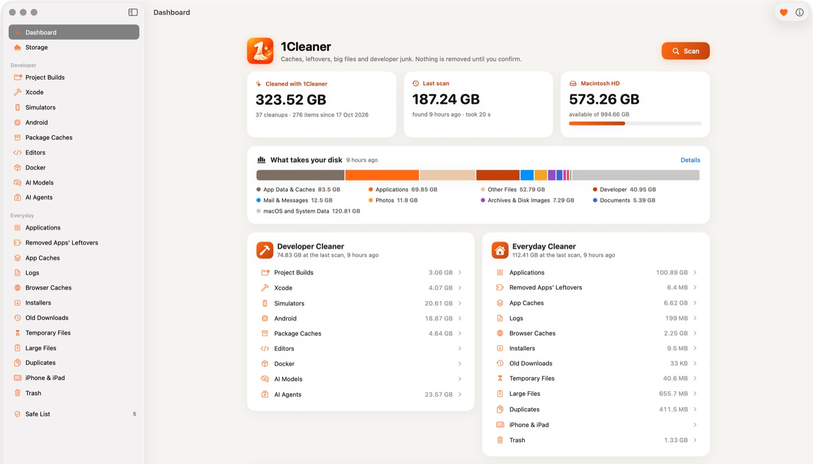
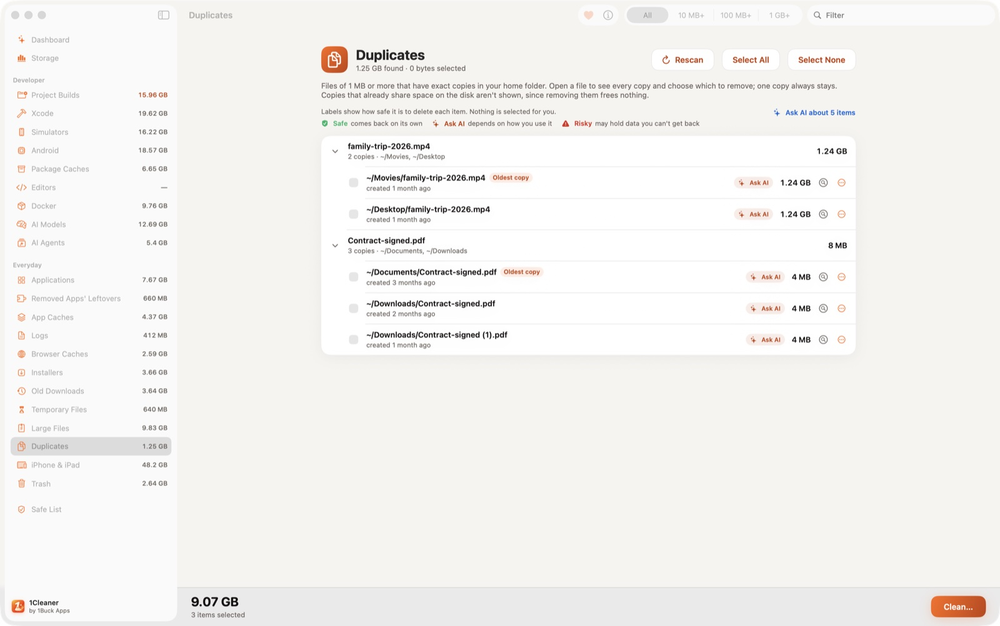
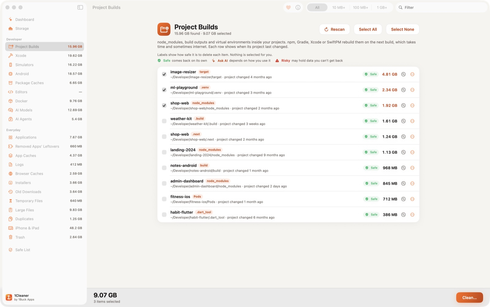
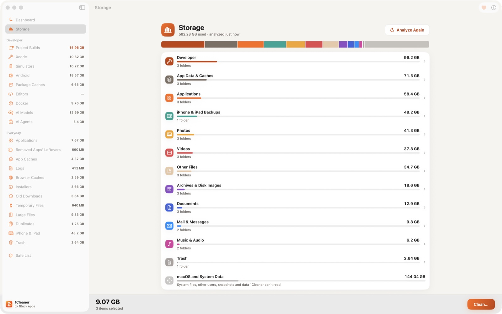

# 1Cleaner for Mac

A free, open-source Mac cleaner for everyone, with a developer cleaner built in. It finds app caches, leftovers of
removed apps, old downloads, large files and duplicates, and on a developer's Mac also `node_modules` and other
build folders, Xcode DerivedData, simulators, Android SDK data, package-manager caches, Docker and AI agents' data.

Nothing is selected for you, and every file goes to the Trash after a confirmation. No account, no ads, no
analytics, no subscription.

**Download:** [onebuckapps.com/1cleaner-mac](https://onebuckapps.com/1cleaner-mac/) — a DMG signed with a Developer
ID and notarized by Apple. macOS 14 or later, Apple silicon and Intel. 17 languages.



*The dashboard is from the developer's own Mac; the other screenshots use the app's demo data.*

## What it cleans

**Everyday**
- Apps together with their data (with Full Disk Access also the data they share with their extensions), and
  leftovers of apps you already removed
- App caches (including App Store apps with Full Disk Access), logs and browser caches
- Installers, old downloads and temporary files nobody touched for days
- Large files and exact duplicates: you choose which copies go, one copy always stays
- iPhone and iPad backups and downloaded updates, and the Trash itself



**Developer**
- Project build folders (`node_modules`, `.next`, `.build`, Gradle `build`, Rust and Maven `target`, `Pods`,
  Flutter, Python virtual environments), offered only next to the file that proves the tool, with the date the
  project last changed
- Git worktrees, the extra working copies AI agents and parallel branches leave, grouped by repository with their
  branch, last change and whether everything is committed; the branch stays in the repository
- Xcode DerivedData, caches, previews, device support files and archives; simulator devices and runtimes; other
  copies of Xcode
- Android NDKs, SDK build tools and platforms, Gradle caches, emulators and system images
- Package-manager caches: npm, Yarn, pnpm, Bun, pip, uv, Poetry, Homebrew, CocoaPods, SwiftPM, Go, Cargo, Dart,
  NuGet, Maven and more; editor caches
- Docker: stopped containers, unused images, build cache and unused volumes
- Local AI models and old sessions, backups and leftovers of AI coding agents



**Storage** shows the disk by kind of data, then folders, subfolders and the largest files. It's read-only.
**Large Folders** (in Everyday) lists the folders that are big because of thousands of small files, like caches,
`node_modules` and exported image sets. View only.



## How it stays safe

- **Nothing is preselected.** You check every item yourself.
- **Every file goes to the Trash** after a confirmation that lists what moves, so you can put it back until you
  empty the Trash. Docker items and simulators can't go to the Trash: they are removed by Docker's and Xcode's own
  tools after a separate red warning.
- **Each item has a label:** Safe (comes back on its own), Ask AI (depends on how you use it) or Risky (may hold
  data you can't get back). Ask AI copies a ready question about the item for any AI assistant.
- **Checked again before removal:** the path must be the same file the scan found (device and inode), not a
  symbolic link, inside your home folder (the only exceptions: apps in /Applications, temporary folders, and scan
  folders you added on other disks). Your own files (large files, installers, old downloads, duplicates) must be
  unchanged since the scan. Apps you remove, editors' and browsers' caches, Claude's virtual machine, Android
  emulators and simulators aren't removed while they run.
- **Never touched:** iCloud's and file-sync services' own data.
- **Build folders and caches only:** project builds come without the source code, lockfiles, `.git`, credentials,
  signing keys and tool settings next to them, and a build folder is offered only next to the file that proves its
  tool (`node_modules` next to `package.json`). Old downloads, large files and duplicates are your own files: look
  at them before you remove them.
- **Safe List** keeps an item, a whole project or a folder out of every future scan.

## Privacy

Scans run on your Mac. The app goes online only when you ask: Check for Updates reads one small file,
[`version.json`](https://onebuckapps.com/1cleaner-mac/version.json), and Install and Relaunch downloads the new
version from onebuckapps.com. Nothing about your Mac is sent. Full Disk
Access is optional. [Privacy policy](https://onebuckapps.com/1cleaner-mac/privacy/).

## Build from source

Requirements: macOS 14 or later, Xcode 16 or later. No third-party dependencies.

```bash
git clone https://github.com/eh0tka/1cleaner-mac.git
cd 1cleaner-mac
xcodebuild -project OneCleanerMac.xcodeproj -scheme OneCleanerMac -configuration Release -derivedDataPath build build
open build/Build/Products/Release/1Cleaner.app
```

This builds an ad-hoc signed app that runs on your own Mac. Or open `OneCleanerMac.xcodeproj` in Xcode and run the
`OneCleanerMac` scheme. `tools/release.sh` builds the signed, notarized DMG (it needs a Developer ID certificate).

## Contributing

Issues and bug reports are welcome, especially about anything the app offers that it shouldn't. See
[CONTRIBUTING.md](CONTRIBUTING.md) before opening a pull request, and [SECURITY.md](SECURITY.md) for anything that
could remove the wrong files.

## Support the developer

1Cleaner is free. If it saved you space or time, you can [support the developer with crypto](https://onebuckapps.com/donate/).

## License

GPL-3.0: see [LICENSE](LICENSE). You may use, study, change and share the code; if you distribute a changed
version, its source must stay open under the same license.

The name "1Cleaner", the 1Buck Apps name and the app icon are not covered by the license: a fork must use its own
name and icon.

Made by [1Buck Apps](https://onebuckapps.com/).
